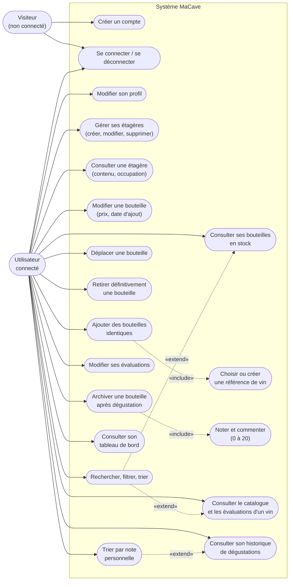
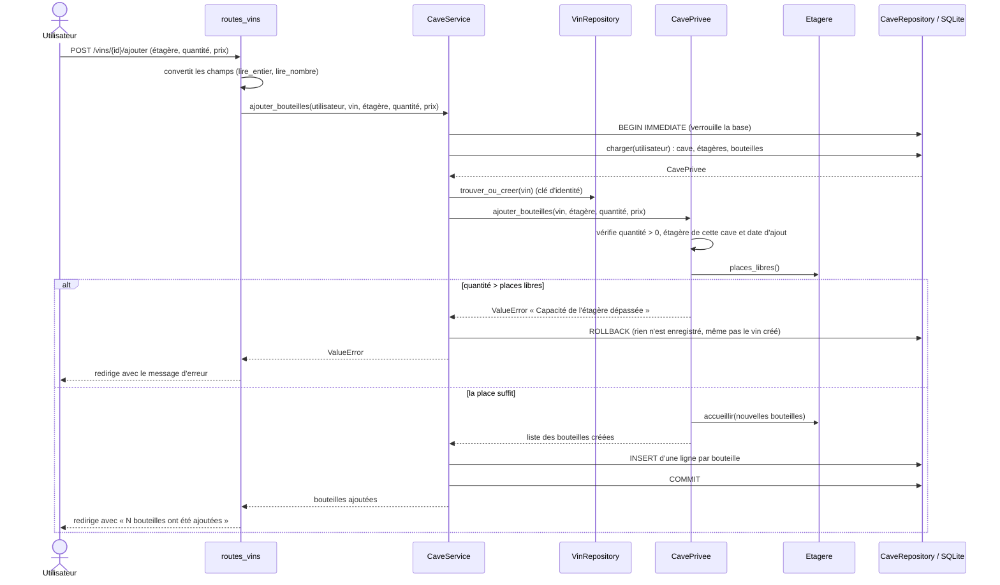
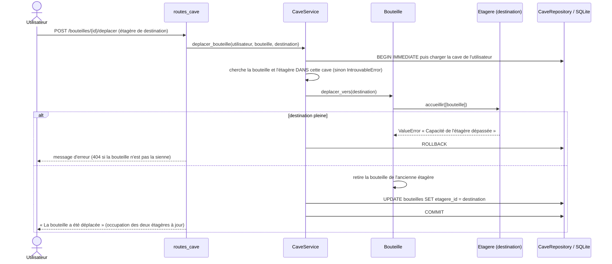
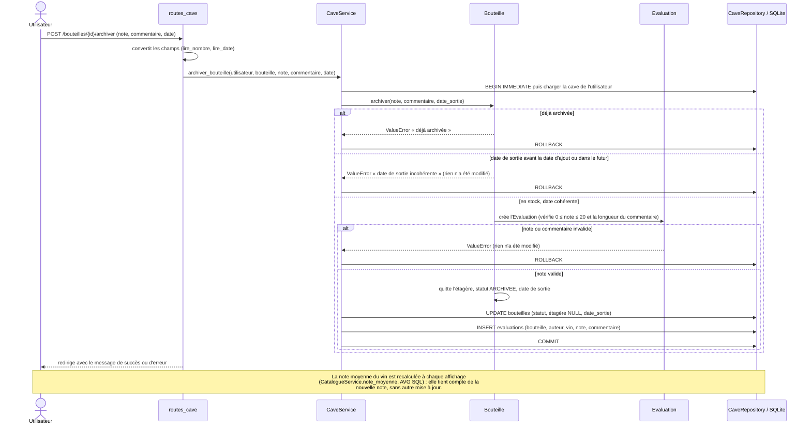
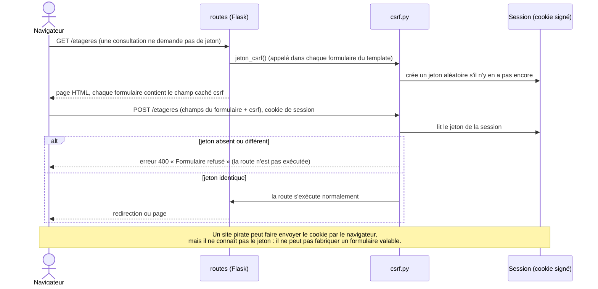
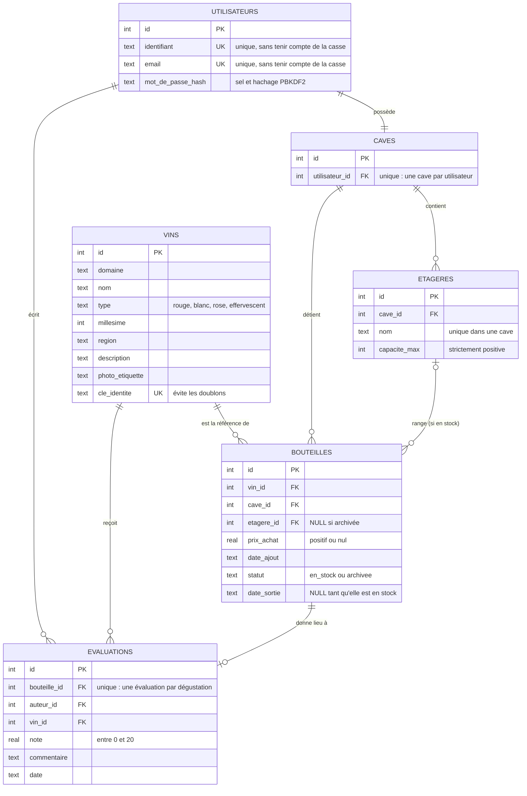
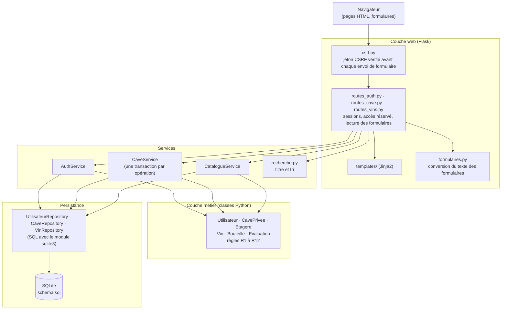

# Diagrammes UML de MaCave

Les diagrammes sont cohérents avec le code actuel. Les schémas écrits en Mermaid sont du texte : GitHub et
GitLab les affichent directement et ils se modifient à la main. Le diagramme de classes est un fichier
draw.io (source éditable).

| Diagramme | Où |
|---|---|
| Diagramme de classes | [diagramme_de_classes.drawio](diagramme_de_classes.drawio) (à ouvrir avec <https://app.diagrams.net>) |
| Diagramme de cas d'utilisation | ci-dessous |
| Diagrammes de séquence (ajout multiple, déplacement, archivage avec évaluation, envoi d'un formulaire et jeton CSRF) | ci-dessous |
| Modèle relationnel | ci-dessous |
| Architecture en couches | ci-dessous |

## Diagramme de classes (résumé)

Le diagramme complet, avec les attributs typés et les multiplicités, est dans le fichier draw.io.
Voici les relations principales, pour les lire sans ouvrir le fichier :

```mermaid
classDiagram
    direction LR
    class Utilisateur {
        +int id
        +str identifiant
        +str email
        +str mot_de_passe_hash
        +verifier_mot_de_passe(mdp) bool
        +modifier_profil(email, mdp) void
    }
    class CavePrivee {
        +int id
        +appartient_a(utilisateur) bool
        +creer_etagere(nom, capacite_max) Etagere
        +modifier_etagere(etagere, nom, capacite_max) void
        +supprimer_etagere(etagere) void
        +ajouter_bouteilles(vin, etagere, quantite, prix_achat, date_ajout) List~Bouteille~
        +bouteilles_en_stock() List~Bouteille~
        +historique() List~Bouteille~
        +nb_bouteilles() int
        +nb_references() int
        +capacite_totale() int
        +occupation_globale() float
        +valeur_stock() float
    }
    class Etagere {
        +int id
        +str nom
        +int capacite_max
        +int occupation
        +places_libres() int
        +taux_occupation() float
        +est_vide() bool
        +modifier_capacite(capacite_max) void
        +accueillir(bouteilles) void
        +retirer(bouteille) void
    }
    class Vin {
        +int id
        +str domaine
        +str nom
        +TypeVin type
        +int millesime
        +str region
        +str description
        +str photo_etiquette
        +cle_identite() str
        +est_le_meme_vin_que(autre) bool
    }
    class Bouteille {
        +int id
        +float prix_achat
        +date date_ajout
        +StatutBouteille statut
        +date date_sortie
        +est_en_stock() bool
        +modifier_infos(prix_achat, date_ajout) void
        +deplacer_vers(destination) void
        +retirer() void
        +archiver(note, commentaire, date_sortie) Evaluation
    }
    class Evaluation {
        +int id
        +float note
        +str commentaire
        +datetime date
        +est_modifiable_par(utilisateur) bool
        +modifier(auteur, note, commentaire) void
    }
    class TypeVin {
        <<enumeration>>
        ROUGE
        BLANC
        ROSE
        EFFERVESCENT
    }
    class StatutBouteille {
        <<enumeration>>
        EN_STOCK
        ARCHIVEE
    }
    Utilisateur "1" *-- "1" CavePrivee : possède
    CavePrivee "1" *-- "0..*" Etagere : contient
    CavePrivee "1" *-- "0..*" Bouteille : détient
    Etagere "0..1" o-- "0..*" Bouteille : stocke (en stock)
    Vin "1" <-- "0..*" Bouteille : exemplaire de
    Bouteille "1" -- "0..1" Evaluation : donne lieu à
    Evaluation "0..*" --> "1" Vin : concerne
    Utilisateur "1" <-- "0..*" Evaluation : auteur
    Vin --> TypeVin
    Bouteille --> StatutBouteille
    note for Bouteille "Contraintes :\ndate_ajout ≤ date du jour\ndate_ajout ≤ date_sortie ≤ date du jour\nARCHIVEE ⇒ pas d'étagère, date_sortie renseignée\nEN_STOCK ⇒ étagère renseignée, pas de date_sortie"
```

La distinction demandée par le sujet apparaît clairement : un **Vin** est une référence du catalogue
(commune à tous les utilisateurs) ; une **Bouteille** est un exemplaire physique rattaché à une seule cave et à
une seule référence. Cinq bouteilles identiques sont donc cinq `Bouteille` qui pointent vers un seul `Vin`.

La **note moyenne n'est pas une méthode de `Vin`** : elle porte sur les évaluations de *tous* les utilisateurs,
alors qu'un `Vin` chargé avec une cave ne connaît que celles de cet utilisateur. Une `Evaluation` connaît son `Vin`
(navigabilité `Evaluation` → `Vin`), mais un `Vin` n'a pas de liste d'évaluations. La moyenne est calculée à un
seul endroit, `CatalogueService.note_moyenne` (SQL `AVG`), voir le diagramme d'architecture plus bas.

## Diagramme de cas d'utilisation

Mermaid n'a pas de type « cas d'utilisation » : il est dessiné avec un diagramme de flux (acteurs à gauche,
cas d'utilisation dans la frontière du système, `«include»` en pointillés).

Règle R1 (accès) : tous les cas d'utilisation de l'utilisateur connecté s'appliquent **à sa propre cave** ;
seul le catalogue et les évaluations sont communs à tous les utilisateurs connectés.

## Diagrammes de séquence

### Ajout de plusieurs bouteilles identiques (opération atomique)

### Déplacement d'une bouteille

### Archivage d'une bouteille avec évaluation

### Envoi d'un formulaire et protection CSRF

Chaque formulaire POST contient un champ caché `csrf`. Le serveur refuse tout envoi dont le jeton n'est pas celui de
la session, avant même d'exécuter la route (voir `macave/csrf.py`).

## Modèle relationnel

Le schéma SQL complet (types, contraintes `CHECK`, `UNIQUE`, clés étrangères) est dans
[`macave/schema.sql`](../../macave/schema.sql).

## Architecture en couches

Les règles de gestion (capacité, déplacement, archivage, dates, identité d'un vin) sont portées par les classes
du métier, qui ne connaissent ni Flask ni SQLite : les tests de `tests/test_modele.py` les vérifient sans base ni requête HTTP.

La note moyenne d'un vin fait exception : elle porte sur les évaluations de tous les utilisateurs, alors qu'une cave ne
charge que les siennes. Elle est calculée par `CatalogueService.note_moyenne` (SQL `AVG`, via `VinRepository`), et testée
elle aussi sans requête HTTP (`tests/test_catalogue_service.py`).
